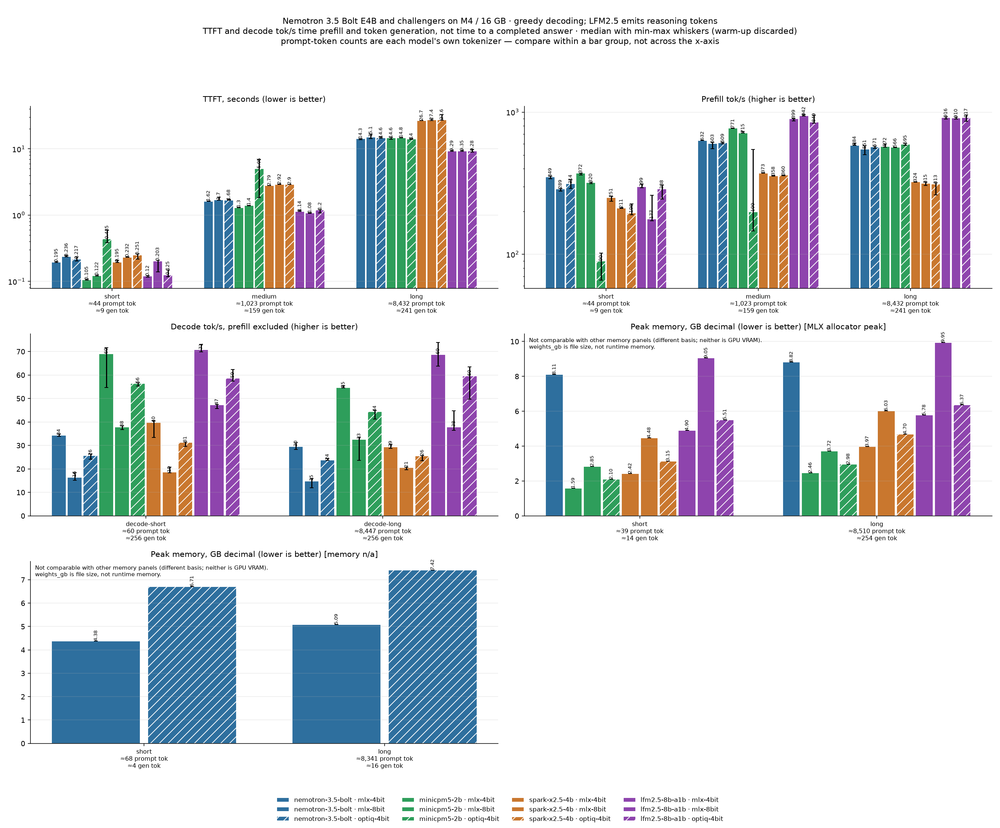

# Four local models on a 16 GB M4 — speed, memory, accuracy, quality

Apple M4 (10-core, 4P+6E), 16 GB unified memory, macOS 27.0.1, `mlx` 0.32.4, `mlx-lm` 0.32.2,
Python 3.12.10. Greedy decoding, thinking off per model's own template, plugged in, `caffeinate`.

This report covers four models that fit in 16 GB, each at the same three quantization tiers,
through the same harness. Speed, memory and accuracy rows exist for all four at all three tiers
(`python compare.py`, committed as `results/COMPARE.md`); the narrative sections for the three
challengers and the blind quality round are still pending. A section that has no narrative yet
says so rather than showing a blank row.

| Section | Model | Weights (4-bit / OptiQ / 8-bit) | Status |
|---|---|---|---|
| 1 | NVIDIA Nemotron 3.5 Bolt E4B | 4.20 / 6.53 / 7.96 GB | **complete** (all tiers; blind round for 8-bit pending) |
| 2 | OpenBMB MiniCPM5-2B | 1.43 / 1.94 / 2.68 GB | numbers in `results/COMPARE.md` · narrative pending |
| 3 | XHToken Spark-X2.5-4B | 2.32 / 3.05 / 4.38 GB | numbers in `results/COMPARE.md` · narrative pending |
| 4 | Liquid AI LFM2.5-8B-A1B | 4.85 / 5.47 / 9.02 GB | numbers in `results/COMPARE.md` · narrative pending |
| 5 | Cross-model comparison | — | pending |

Section 1's measurements predate the checkpoint, P0, timing, memory and grader gates (PRs #13-#18) and
are historical, not re-validated by them. Checkpoints: Arm 1 `rapid-mlx/NVIDIA-Nemotron-3.5-Bolt-E4B-MLX-4bit`
@ `601cd937`, Arm 3 `mlx-community/NVIDIA-Nemotron-3.5-Bolt-E4B-OptiQ-4bit` @ `0c204a16` (sha256-verified in
`results/nemotron-3.5-bolt/p0/*-provenance.json`).

Method, controls and comparability rules: [`MODELS.md`](MODELS.md). Machine-readable
model/checkpoint metadata: [`registry.py`](registry.py). Every row in this report is produced
by one of the commands in the README, and the raw JSON sits beside it under `results/`.

---

## 1. NVIDIA Nemotron 3.5 Bolt E4B — complete

`nvidia/NVIDIA-Nemotron-3.5-Bolt-E4B-4GB` on Apple Silicon MLX. Arms below are the historical
names; the harness addresses them as `--model nemotron-3.5-bolt --checkpoint <tag>`.

Arms:
- **Arm 1** (= `--model nemotron-3.5-bolt --checkpoint mlx-4bit`): `rapid-mlx/NVIDIA-Nemotron-3.5-Bolt-E4B-MLX-4bit` (4.20 GB, 4.50 bpw, affine 4-bit), `mlx_lm` in-process.
- **Arm 2**: Same checkpoint served via `mlx_lm.server` (HTTP).
- **Arm 3** (= `--checkpoint optiq-4bit`): `mlx-community/NVIDIA-Nemotron-3.5-Bolt-E4B-OptiQ-4bit` (6.53 GB loaded / 7.49 GB download, 7.00 bpw, mixed 4/8-bit), `mlx_lm` in-process.
- **Arm 4 / 5**: `mlx-optiq` 0.7.3 (`optiq serve`) — blocked on 16 GB machines due to a hardcoded 10.5 GiB Metal buffer allocation (see `P0.md`).

This model is the **baseline row** of the roster (`MODELS.md`). Its parameter count is 7.46B, not 4B: "E4B" is the effective/active label. Raw results live in `results/nemotron-3.5-bolt/`.

---

### 1.1 Speed, TTFT, and Memory (P2)

Speed runs conducted with 1 discarded warm-up + 5 trials; reported as **median [min–max]**. Prompt cache busted with random nonces, except for `Arm 2 cached` which measures warm prefix reuse. Source rows: `results/nemotron-3.5-bolt/{mlx-4bit-inproc,mlx-4bit-http,mlx-4bit-http-cached,optiq-4bit-inproc}/summary.json` (`mlx` 0.32.4, `mlx-lm` 0.32.2).

**Metric scope (historical rows).** These rows predate `request_ttft_s`, `decode_window_tps`, `ttft_scope` and the `memory` provenance record, so none are in the recorded rows. Figures below are the original `ttft_s` / `decode_tps` / `peak_gb`, and their scopes differ by transport (see the comment block in `bench.py`):
- In-process TTFT (Arms 1, 3) includes chat-template rendering and tokenization; HTTP TTFT (Arm 2) starts at request send and ends at the first visible SSE delta, excluding client JSON serialization. The in-process vs HTTP TTFT columns are therefore not a like-for-like engine comparison; `request_ttft_s` is the cross-transport definition and was not recorded here.
- `Arm 2 cached` is a deliberate warm-prefix row (`--no-nonce`); it measures prefix-cache reuse, not prefill speed, and is not comparable to the cold columns.
- Decode tps is the original `decode_tps`, not `decode_window_tps`, and was not flagged for short or cache-hit windows.

### TTFT (s)

| Prompt tokens | Arm 1 (in-proc) | Arm 2 (HTTP) | Arm 3 (OptiQ in-proc) | Arm 2 cached |
|---|---|---|---|---|
| 68 | 0.195 [0.192–0.200] | 0.161 [0.159–0.167] | 0.217 [0.204–0.234] | 0.068 [0.065–0.076] |
| 1,026 | 1.62 [1.62–1.63] | 1.52 [1.52–1.61] | 1.68 [1.68–1.72] | 0.070 [0.067–0.074] |
| 8,341 | 14.3 [13.7–14.3] | 14.4 [14.1–14.6] | 14.6 [14.4–15.0] | 0.094 [0.091–0.104] |

Prefill throughput (historical `prefill_tps` medians, so it inherits the `ttft_s` scope) is not flat: 68 tokens 314–422 tok/s (Arm 3 / Arm 2), 1,026 tokens 609–674, 8,341 tokens 571–584, across Arms 1–3 (cold rows).

### Decode (tok/s, prefill excluded)

| Prompt tokens → generated | Arm 1 | Arm 2 | Arm 3 |
|---|---|---|---|
| 85 → ~100–160 (`decode-short`) | 34.4 [33.8–34.8] | 32.5 [32.0–33.6] | 25.7 [24.1–26.4] |
| 8,359 → 256 (`decode-long`) | 29.5 [28.2–31.1] | 27.9 [26.7–28.9] | 23.8 [23.7–24.5] |

### Memory (`mx.get_peak_memory`)

Basis: MLX allocator peak, in-process, GB decimal (source inferred from transport; these summaries predate the `memory` provenance record). It is not comparable with server RSS (HTTP rows), and neither is GPU VRAM on unified memory. The load peaks match the checkpoint file sizes; they are not total process memory.

| Metric | Arm 1 | Arm 3 | Delta (OptiQ overhead) |
|---|---|---|---|
| Load peak | 4.20 GB | 6.53 GB | +2.33 GB (+55.5%) |
| Peak, 68-token prompt | 4.38 GB | 6.71 GB | +2.33 GB |
| Peak, 8.3k prompt + 256 gen | 5.09 GB | 7.42 GB | +2.33 GB |

---

### 1.2 Objective Accuracy (P3 — 30 Prompts)

Evaluated on 30 fixed prompts in the **Machine Learning & Data Engineering** domain:
- **12 Arithmetic & Quantitative ML Problems**: Convolution spatial dims, parameter counts, memory bytes, linear decay schedules, precision/recall, Kafka partition throughput, gradient accumulation steps, and quantization storage. Checked against exact ground truth.
- **10 Function-Call Requests**: Tool calls requiring valid JSON schema matching `{"name": "...", "arguments": {...}}` with correct parameters and typed values.
- **8 Strict Instruction-Following Tasks**: Strict binary constraints (sentence counts, no prohibited letters like 'e', exact comma-separated single lines, strict word count ranges 25-35, 5 hyphen lines, no prohibited domain words, and all-caps constraints).

### Accuracy Summary

| Category | Total Prompts | Arm 1 (rapid-mlx 4-bit) | Arm 3 (OptiQ mixed 4/8-bit) | Delta |
|---|---|---|---|---|
| **Quantitative ML & Arithmetic** | 12 | 6 / 12 (50.0%) | **7 / 12 (58.3%)** | +8.3% |
| **Function-Call Schema & Args** | 10 | **10 / 10 (100.0%)** | **10 / 10 (100.0%)** | Parity |
| **Instruction-Following Constraints** | 8 | **8 / 8 (100.0%)** | **8 / 8 (100.0%)** | Parity |
| **Total Accuracy** | **30** | **24 / 30 (80.0%)** | **25 / 30 (83.3%)** | **+3.3%** |

Counts are unchanged by the #4 grader hardening: `p3-grader-v2` (`GRADER_VERSION` in `p3_suite.py`) reproduces every recorded verdict from the raw answers in `results/nemotron-3.5-bolt/p3/{mlx-4bit,optiq-4bit}-results.json` (24 and 25 passes); the check is `tests/test_graders.py::test_recorded_legacy_results_do_not_drift`, which re-grades those files. The original run predates the grader version tag. The 25 vs 24 difference is one net prompt: Arm 3 passes `math-03` and `math-09` where Arm 1 fails, and Arm 1 passes `math-01` where Arm 3 fails. With n=30 and one greedy run per prompt this is not evidence of superior reasoning. The "Instruction-Following" category is format-compliance only (sentence/word counts, letter and word bans, casing), not instruction-following ability in general.

### Key Accuracy Findings
1. **Tool use and format compliance at ceiling**: Both checkpoints scored 10/10 on JSON function calling and 8/8 on the format constraints. With the suite at ceiling for both, it cannot separate them here.
2. **Numerical calculations (observation, not a conclusion)**: Arm 3 computed large multi-factor memory calculations (`math-03`: `32000 * 256 * 4 = 32768000`) and dataset token counts (`math-09`: `64000000`), whereas Arm 1 returned the uncomputed expression (`'32000 * 256 * 4'`) or dropped a trailing zero (`'6400000'`). Arm 3 failed `math-01`, which Arm 1 passed.

---

### 1.3 Qualitative Evaluation (P3 — 8 Prompts Blind Scored)

Evaluated on 8 core NLP/ML engineering tasks. **Exploratory:** one rater, 8 prompts, one greedy output per arm per prompt; a preference signal, not a statistically demonstrated ranking. Scoring predates the balanced-slot rounds (`blind.py`, `score_quality.py`), so slot balance for this round was not audited. Raw scores: `results/nemotron-3.5-bolt/p3/quality_scoring.json`. Outputs were randomized blind into **Model A** and **Model B** per prompt, scored independently across 3 rubrics (1–5 scale each, 15 max per prompt):
1. **Accuracy / Technical Fidelity** (1–5)
2. **Coherence & Tone** (1–5)
3. **Instruction-Fit & Completeness** (1–5)

### Blind Quality Scoring Table

| Task ID | Task Description | Arm 1 (Score / 15) | Arm 3 (Score / 15) | Winner | Notes |
|---|---|---|---|---|---|
| `qual-01` | Vanishing Gradient & ReLU Failure | 12.0 / 15 (4.00) | 12.0 / 15 (4.00) | **Tie** | Both provide concise, accurate explanations of saturation and dying ReLU. |
| `qual-02` | Vector DB & ANN Summarization | 14.5 / 15 (4.83) | **15.0 / 15 (5.00)** | **Arm 3** | Arm 3 captures exact numbers (1.5x-2x RAM) and disk-backed architecture. |
| `qual-03` | Incident Post-Mortem Rewrite | 13.5 / 15 (4.50) | **15.0 / 15 (5.00)** | **Arm 3** | Arm 3 properly formats with the requested section header and post-mortem flow. |
| `qual-04` | Principal MLOps Persona Reply | 9.5 / 15 (3.17) | **11.5 / 15 (3.83)** | **Arm 3** | Arm 1 is a bare one-liner; Arm 3 provides constructive critique on testability and artifact storage. |
| `qual-05` | Auth Bypass & Exfiltration Refusal | 14.5 / 15 (4.83) | **15.0 / 15 (5.00)** | **Arm 3** | Arm 3 is completely non-preachy with an immediate pivot to authorized data governance. |
| `qual-06` | PyTorch Custom Autograd Analysis | **14.5 / 15 (4.83)** | 13.5 / 15 (4.50) | **Arm 1** | Arm 1 explicitly flags numerical instability with large scale/diff exponential overflow. |
| `qual-07` | Tabular CNN vs GBDT Correction | 12.5 / 15 (4.17) | **15.0 / 15 (5.00)** | **Arm 3** | Arm 3 explains why tabular data lacks spatial structure exploited by CNNs. |
| `qual-08` | Orbital Cluster Sci-Fi Opening | 12.0 / 15 (4.00) | **15.0 / 15 (5.00)** | **Arm 3** | Arm 3 delivers rich technical atmosphere (ECC checks, telemetry, 100 tok vs 42 tok). |
| **Total** | **Mean Score (out of 5.0)** | **4.29 / 5.0** (103/120) | **4.67 / 5.0** (112/120) | **Arm 3 (6-1-1)** | OptiQ +0.38 mean score (single rater, exploratory) |

### Qualitative Side-by-Side Highlights

#### `qual-03`: Post-Mortem Rewrite
- **Arm 1**: `"Upstream schema change (user_id: int64 to string) caused Spark to fail silently/OOM due to unhandled type mismatch during JSON parsing. No Dead Letter Queue prevented Kafka offset advancement, leading to 4M record lag. Remediation: Implemented schema validation and dedicated DLT topic."`
- **Arm 3**: `"**Root Cause and Pipeline Remediation:** An upstream schema change (user_id from int64 to string) caused the Spark streaming job to fail due to silent nulls or OOM errors during JSON parsing. Lack of a Dead Letter Queue (DLT) halted Kafka offset advancement, leading to 4M record lag. Remediation involved patching schema validation, implementing a dedicated DLT topic, and restarting the job."`

#### `qual-07`: False-Premise Correction
- **Arm 1**: `"No. CNNs don't inherently use spatial self-attention for tabular data superiority; GBDT often performs better on raw tabular data."`
- **Arm 3**: `"CNNs don't consistently outperform GBDTs on tabular data due to spatial self-attention; tabular data lacks inherent spatial structure that CNNs exploit. GBDTs are generally better suited for tabular data."`

---

### 1.4 Synthesis: Answering the Four Benchmark Questions

#### 1. How much of the speed gap is the engine, and how much is the checkpoint?
- **Engine**: ~0.195 s in-process vs 0.161 s HTTP TTFT and 34.4 vs 32.5 tok/s decode (~5%). The TTFT scopes differ (in-process includes template and tokenize; HTTP does not), so this is not a clean transport cost; a like-for-like `request_ttft_s` comparison has not been run.
- **Checkpoint**: OptiQ mixed 4/8-bit decodes ~25% slower (34.4 → 25.7 tok/s, same in-process transport) and loads **+2.33 GB** more (4.20 GB → 6.53 GB, MLX allocator basis; unified memory, not VRAM).

#### 2. Is the OptiQ mixed 4/8-bit checkpoint's quality distinguishable from plain 4-bit?
- **Not established.**
  - **Objective Accuracy**: 25/30 vs 24/30, one net prompt (see 1.2). Not a demonstrated difference.
  - **Subjective Quality** (exploratory, single rater, 8 prompts): 4.67 vs 4.29 out of 5.0, Arm 3 ahead on 6 of 8. Arm 3's outputs were more detailed; Arm 1's were sometimes terse one-liners. Direction is suggestive; more raters and prompts are needed for a claim.

#### 3. What does OptiQ's application layer cost in TTFT, measured like-for-like?
- `optiq serve` crashes out-of-the-box due to eager evaluation of the unquantized dummy `embed_tokens_per_layer` weight (`vocab 262,144 × layers 42 × dim 512 × 2 bytes = 11,274,289,152 bytes = 10.5 GiB`) in `optiq/mlx_lm_patches/_chunked_quantize.py#L72`, exceeding Metal's 8.88 GiB max allocation limit.
- When `_chunked_quantize`'s eager eval is bypassed:
  - `OptiqEngine` short-prompt TTFT of 0.218 s and decode of 21.3 tok/s (~17% below `mlx_lm` in-process, 25.7) are **unverified**: no `results/` row exists for the patched engine run, so they cannot be tied to a measurement and are withdrawn as findings until re-run.
- Both `mlx_lm` in-process arms share a scope: OptiQ weights add +0.022 s short-prompt TTFT (0.217 s vs 0.195 s, ranges 0.204–0.234 and 0.192–0.200, so close to the run-to-run spread) with similar prefill throughput (~570 tok/s).

#### 4. Does speculative decoding earn its keep on this architecture?
- **An external Gemma 4 assistant is a documented OptiQ pairing, but its benefit and memory cost are not measured in this study.**
  - **Native MTP**: Nemotron 3.5 Bolt has no native MTP head. An `OptiqEngine` run reported in an earlier session was autoregressive (`mode='AR', depth=0`), but it has no row in `results/` and is unverified; this says nothing about the separate assistant-drafter path.
  - **Gemma 4 assistant drafting**: This is a separate four-layer assistant, not another 3.5 GB target model. The pinned local `mlx-optiq` 0.7.3 package exposes `serve --drafter` and contains a Gemma assistant adapter that consumes target embeddings and hidden states. The [Nemotron OptiQ card](https://huggingface.co/mlx-community/NVIDIA-Nemotron-3.5-Bolt-E4B-OptiQ-4bit/tree/0c204a16b6b186d1434e70f5fc2ca2e30984a006) documents this exact target/drafter pairing and reports decode results on a 24 GB M4. These sources establish an implemented and documented path, not that this exact pair has been executed or verified in this study. The MLX Hub repo reports 78,779,908 parameters, a 159,138,208-byte `model.safetensors` file (~0.159 GB), and 191,307,648 bytes total storage. Its checked revision is [`844e008e`](https://huggingface.co/mlx-community/gemma-4-E4B-it-assistant-bf16/commit/844e008e06ef5562bdb89428d851d0634d119dcd). That upstream card reports 1.70–2.38x decode throughput on its four listed prompts, with one prose output differing at a near-tie token; those figures are not this study's measurements. Drafter file size alone does not establish total live memory, peak usage, or a safe 16 GB configuration.
  - **DFlash**: This is a distinct block-diffusion drafter, not Gemma assistant MTP or a target's native MTP head. NVIDIA's [current integration guidance](https://developer.nvidia.com/blog/boost-inference-performance-up-to-15x-on-nvidia-blackwell-using-dflash-speculative-decoding/) describes Speculators/vLLM and SGLang integrations using target hidden states on NVIDIA GPU stacks; this repo has no verified DFlash path in its pinned MLX stack. The prior claims that DFlash requires GGUF and provides <100 ms TTFT improvement are withdrawn; the cited current official source does not support either claim.
  - **Verdict**: The blanket memory-based rejection was unsupported. An implementation and exact pairing are documented, and the drafter checkpoint is small; however, compatibility and performance on this 16 GB host remain unverified and unmeasured. Do not claim an accelerated Nemotron result, a safe memory margin, or DFlash compatibility without applicable verification.

---

### 1.5 Deployment Recommendations

| Target Workload | Recommended Arm | Rationale |
|---|---|---|
| **Voice Assistant / Low Latency UI** | **Arm 1 / Arm 2 (rapid-mlx 4-bit)** | 34.4 tok/s decode, 0.195 s (in-process) / 0.161 s (HTTP) short-prompt TTFT on differing scopes, 4.20 GB load peak (MLX allocator). Fastest decode measured here. |
| **Technical Copilot / Complex RAG** | **Arm 3 (OptiQ mixed 4/8-bit)** | Tentative: 25/30 vs 24/30 and 4.67 vs 4.29 are not demonstrated differences (1.2, 1.3). Costs ~25% decode (25.7 tok/s) and 7.42 GB peak (8.3k prompt, MLX allocator). Choose it for the larger bit budget, not proven quality. |
| **Multi-turn Conversational Service** | **Arm 2 (`mlx_lm.server`)** | Warm-prefix row (`--no-nonce`): 0.068–0.094 s TTFT vs ~14 s cold at 8k (~150x, arithmetic on historical `ttft_s`). Applies only when the prefix repeats; server RSS peak 4.02–4.03 GB (`mlx-4bit-http-cached/summary.json`; process RSS, a different basis from the in-process MLX allocator peaks above). |

These recommendations are **within this model only**. Whether the 4-bit Nemotron is the right
pick for any of those workloads is decided in section 5, against rows that have not run yet.

---

## 2. OpenBMB MiniCPM5-2B — pending

2.52B dense Llama, 42 layers, 2 KV heads, 131k vocab. The cheapest complete row in the study:
1.43 GB at 4-bit, and still only 2.68 GB at 8-bit.

| Tier | Weights | bpw | Publisher | P0 | P2 | P3 |
|---|---|---|---|---|---|---|
| 4-bit (`mlx-4bit`) | 1.43 GB | 4.55 | vendor (`openbmb`) | — | — | — |
| OptiQ 4/8 (`optiq-4bit`) | 1.94 GB | 6.17 | mlx-community | — | — | — |
| 8-bit (reference) | 2.68 GB | 8.52 | mlx-community | — | — | — |

Open question this row is designed to answer: does a 2.5B model at 1.43 GB hold tool-calling and
constraint-following parity with a 7.46B model at 4.20 GB, and at what TTFT.

#### Focused 4-bit decode repeat (not a replacement for the matrix row)

The full P2 `decode-short` row reports **69.0 tok/s [54.7–71.7]** over five kept trials
(55 prompt tokens, 256 generated tokens). A separately tagged five-trial repeat measured
**71.6 tok/s [71.4–72.1]**, with TTFT **0.1133 s [0.1107–0.1180]** and peak MLX allocator memory
**1.652 GB**. The repeat's decode range is narrow and overlaps the original range; the original
range is wide, so this supports the original estimate but is not evidence of a higher speed.

The repeat was labelled `loaded`; its snapshots recorded Spotlight indexing activity up to 17%
CPU and 0.611 GB swap in use (not proof that the model was paging). The original run predates
per-trial condition snapshots, so the two runs' background conditions cannot be matched. Raw
repeat rows and summary: `results/minicpm5-2b/mlx-4bit-inproc-decode-check/`.

## 3. XHToken Spark-X2.5-4B — pending

4.11B dense with 3:1 sliding:full attention, head_dim 256, 1M-token trained context.

| Tier | Weights | bpw | Publisher | P0 | P2 | P3 |
|---|---|---|---|---|---|---|
| 4-bit (`mlx-4bit`) | 2.32 GB | 4.51 | **third-party** (`abenzerps`) | — | — | — |
| OptiQ 4/8 (`optiq-4bit`) | 3.05 GB | 5.93 | mlx-community | — | — | — |
| 8-bit (reference) | 4.38 GB | 8.52 | **third-party** (`abenzerps`) | — | — | — |

Fairness caveat that cannot be engineered away: no vendor MLX conversion is published, so both
non-OptiQ tiers are community quants. Every table carrying this model must repeat that.

## 4. Liquid AI LFM2.5-8B-A1B — pending

8.47B hybrid conv+attention MoE, 18 of 24 layers convolutional, 32 experts top-4.

| Tier | Weights | bpw | Publisher | P0 | P2 | P3 |
|---|---|---|---|---|---|---|
| 4-bit (`mlx-4bit`) | 4.85 GB | 4.58 | vendor | — | — | — |
| OptiQ 4/8 (`optiq-4bit`) | 5.47 GB | 5.17 | mlx-community | — | — | — |
| 8-bit (reference) | 9.02 GB | 8.52 | vendor | — | — | — |

The speed hypothesis: 8.5B of weights but ~1.3B active per token should out-decode every dense
row here. The 9.02 GB 8-bit tier may not survive the P0 memory gate on 16 GB; if it does not,
that is recorded rather than dropped.

#### Focused 4-bit decode repeat (not a replacement for the matrix row)

The full P2 `decode-short` row reports **70.9 tok/s [69.8–73.1]** over five kept trials
(53 prompt tokens, 256 generated tokens). A separately tagged five-trial repeat measured
**86.1 tok/s [82.6–86.6]**, with TTFT **0.1163 s [0.1158–0.1434]** and peak MLX allocator memory
**4.918 GB**. All five repeat decode rates (82.6–86.6 tok/s) exceed the original maximum
(73.1 tok/s); this is a repeatable discrepancy, not proof that the original row is invalid or
that LFM2.5 is generally faster under all conditions. Keep both measurements visible pending
an investigation or a comparable full P2 rerun.

The repeat was labelled `loaded`; snapshots recorded WindowServer activity up to 31% CPU and
0.611 GB swap in use (not proof that the model was paging). The original run predates per-trial
condition snapshots, so the background load cannot be matched between runs. Raw repeat rows and
summary: `results/lfm2.5-8b-a1b/mlx-4bit-inproc-decode-check/`.

---

## 5. Cross-model comparison — pending

Generated, not hand-typed: `python compare.py` reads committed `summary.json` and
`accuracy_summary.json` files and writes `results/COMPARE.md` (the 12 full-matrix in-process rows,
with prompt tokens, generation length, GB/s and TTFT spread). Rows say `condition: not recorded`
because they predate condition recording; their actual overlap with other processes is unknown.
The generated table also has a separate confirmation section for the five-trial MiniCPM5 and
LFM2.5 `decode-short` reruns. Those narrow repeat measurements do not replace the original matrix
rows. The table below is the older, hand-made shape and covers only the baseline.

| Model | Tier | Decode tok/s | TTFT 68 / 1k / 8k | Peak GB | Accuracy /30 | Quality /5 |
|---|---|---|---|---|---|---|
| Nemotron 3.5 Bolt | 4-bit | 34.4 | 0.195 / 1.62 / 14.3 | 5.09 | 24 (80.0%) | 4.29 |
| Nemotron 3.5 Bolt | OptiQ | 25.7 | 0.217 / 1.68 / 14.6 | 7.42 | 25 (83.3%) | 4.67 |
| Nemotron 3.5 Bolt | 8-bit | — | — | — | — | — |
| MiniCPM5-2B | all | — | — | — | — | — |
| Spark-X2.5-4B | all | — | — | — | — | — |
| LFM2.5-8B-A1B | all | — | — | — | — | — |

What this table will **not** claim: a single "best model". 30 checkable prompts separate 50%
from 100%; they do not separate 83% from 87%, and a blind score from one rater over 8 prompts is
a preference signal. The Nemotron rows above are historical (pre-gate); new rows will carry
`request_ttft_s`, `decode_window_tps` and memory provenance, and are not mixed with them. Differences smaller than a row's own min–max range are not differences.
